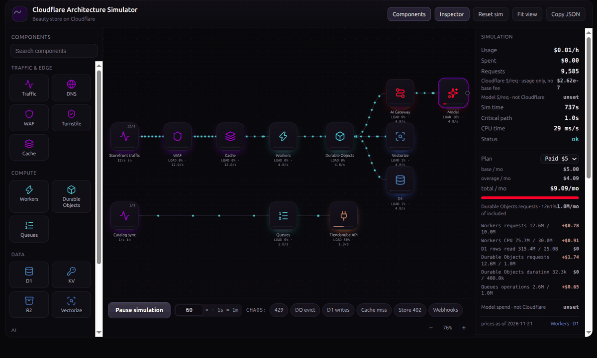
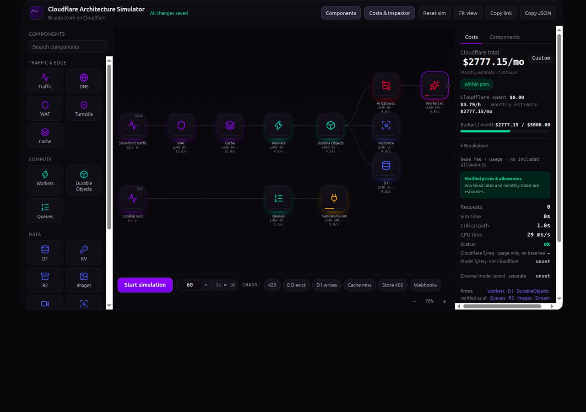
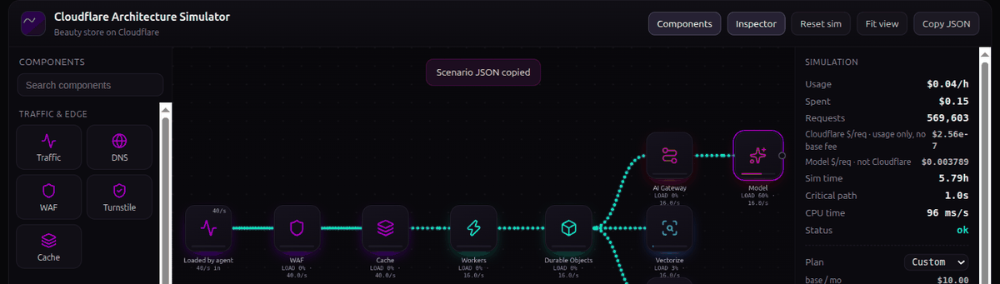

# cloudflare-arch-sim

A drag-and-drop Cloudflare architecture simulator that renders **inside an Orca chat** as a
single self-contained HTML file. Drop components on the canvas, wire them, send simulated traffic,
throw chaos at the system, and watch where it saturates and what it costs per hour.



*The default "Beauty store on Cloudflare" scenario, running with the Paid $5 plan selected.
Every node shows live load and its own status badge; edges carry animated request beads.*

## What it is — and when to use it

Use it to talk through an architecture: "what happens if the store API slows down?", "does the
cache actually save us money?", "which node is the single point of failure?". It is a **model**,
not a load test and not a Cloudflare emulator. It gives you a shared picture you can edit together
in a chat, or embed as one offline HTML file with no runtime dependencies.

Open `dist/cloudflare-arch-sim.html` in Orca, or copy it into `$ORCA_CHAT_SCRATCH_DIR` and emit
`::orca-visual{file="cloudflare-arch-sim.html"}` to render it in the conversation. The static file
is the whole app: CSS, JavaScript and icons are inlined by `build.mjs`. The live, file-backed
channel described below is an optional addition served by `serve.mjs`. External AI agents can use
the optional local [MCP stdio server](docs/mcp.md) without a browser or HTTP listener.

## Agent workflow

Start with [AGENTS.md](AGENTS.md), load [the project skill](skills/cloudflare-arch-sim/SKILL.md), and
follow [the agent playbook](docs/agent-playbook.md). Use [the operator guide](docs/agent-operator.md)
for browser `SIM_API` workflows or [the MCP guide](docs/mcp.md) for local stdio clients. Verify
changes with `npm run typecheck`, `npm run lint`, `npm test`, `npm run check:dist`, and
`npm run pack:check`; use Orca's browser for UI checks. Keep work on a task branch and leave
merging and npm publication to the maintainer.

## Product UX

- **Mobile:** Components and Costs & inspector open as bottom sheets over a full-width canvas. Closed panels are inert, and each sheet has a visible close control.
- **Keyboard:** Tab to canvas nodes or connections, press Enter or Space to select, and press Delete to remove. The inspector's **Connect to** control adds edges without dragging; selecting a connection exposes its **Share %** field. Costs and Components are ARIA tabs with arrow-key navigation.
- **Saving:** The header shows local-only, saving, saved, or error state. Failed writes and disconnected live updates keep a persistent alert with Retry when recovery is possible.
- **Sharing:** **Copy link** uses the existing `#s=` encoder. Links over 8,000 characters fail visibly; use **Copy JSON** instead.
- **Provenance:** Verified prices and limits are grouped separately from editable workload assumptions. Cloudflare totals and external model spend stay distinct, and monthly figures state the 730-hour estimate period.

## Engine model

- **Flow follows the edges.** A source emits `rate` requests/second. Each outgoing edge applies its
  validated 0–100% `weight` to the sender's output rate; missing weights normalize to 100, so a
  90/10 split sends 90% and 10% while multiple 100% edges fan out the full rate. Zero-share edges
  remain visible and editable but carry no traffic.
- **Queueing is M/M/c with Erlang-C.** Service time is the node's `latency` in ms
  (`mu = 1000 / latency`), `c` is `concurrency`, and `util = lambda / (mu * c)`. Erlang-C gives
  the wait; `util >= 1` pins the node at a 30 s wait and paints it red. The series uses the same
  400-server cap on both sides of the boundary. A cache forwards only `1 - hit` of its input.
- **Queues throttle, they don't multiply.** A Queue forwards at most its service capacity, capped
  at the documented 5,000 messages/s; the excess accumulates as a backlog. Backlog evolves with
  simulated time (`backlog = capacity * FIFO wait`, Little's law), and `backlog / capacity` is
  included in Queue and path latency. Messages older than `retention` expire and count as drops.
  Zero capacity forwards nothing: with finite retention it settles at `arrival rate × retention`
  and drops at the arrival rate; with unlimited retention its backlog grows. Assumption: strict
  FIFO, one deterministic service rate and no retries.
- **Durable Objects are sharded explicitly.** `objects` spreads arrivals evenly and compares
  per-object rate with the documented ~1,000 req/s soft limit. HTTP/RPC duration uses service
  time unless monthly active wall-clock seconds are supplied. Non-hibernatable WebSockets use
  the connection-open window; hibernatable WebSockets use actual incoming messages × active
  milliseconds. Duration is capped by each object's available wall time, so overlapping requests
  are not billed repeatedly. Incoming WebSocket messages use the 20:1 request-billing ratio.
- **Errors and alerts.** Above full utilization, `err = min(0.85, (util - 1) * 0.55)`; a store 402
  chaos pins the external node at `err = 1`. The canvas raises `HOT PATH BOTTLENECK`,
  `ERROR BUDGET BURN`, `DATA LOSS RISK` and `SPOF` alerts. The reported critical path is the
  longest chain of node latencies from any source.
- **Beads are decoration.** An edge animates up to 50 beads per second using its weighted share of
  the sender output rate and labels the share on the canvas. The cap is **visual only**;
  utilization, latency and cost always use the real rate, and a zero-share edge stays idle.
- **Chaos uses real time.** The 429, DO eviction, D1 write storm, cache miss, store 402 and
  webhook buttons set expiry with `performance.now()` in **real seconds** (8–12 s depending on
  the button), independently of the simulation-speed multiplier.
- **Verified vs assumption.** The inspector groups documented prices and limits under
  **Verified prices & limits** when `src/catalog.js` carries a `verified` note and source link.
  Documented default values show **Verified default · editable**; workload values show
  **Editable assumptions**. Components without verified notes say **Editable assumptions**, so a
  node-level source never implies that every field is verified.

## Cost model

The cost panel separates Cloudflare spend from model-token spend.

| Row | Meaning |
|---|---|
| `Usage` | Cloudflare spend rate, `$/h` (`rate * 3600`, where `rate` is USD/s across Cloudflare nodes only) |
| `Spent`, `Requests` | Dollars and accepted source requests accumulated since reset |
| `Cloudflare $/req` | `spent / requests`: **usage only, excluding the plan base fee** |
| `Model spend`, `Model $/req` | External-provider token spend, in its own bucket |
| Plan rows | Base fee, overage, projected monthly total and the allowance/budget bar |

Per second, a Cloudflare node costs `lambda * units * price / 1e6` USD. Workers add
`lambda * cpuMs * $0.02/M CPU-ms`; Queues add three operations per message, less expired
messages that were never read. R2 separates Class A, Class B and stored GB. Durable Objects
separate billed requests, shared active GB-s, SQLite rows and stored GB. Images, Stream and
native Workers AI use their own documented dimensions. Non-Cloudflare nodes (the external model
provider and the Tiendanube API) never contribute to Cloudflare usage, spent, `$/req`, overage or
the budget bar. Per-second dollars are projected to a month with `3600 * 730` hours.

**Plans:** *Free* has no base fee and flags the daily limits it exceeds; *Paid $5* adds the
included monthly allowances and bills overage at the unit prices below; *Custom* uses a base fee
plus raw usage against your monthly budget, with no included allowances.

**Verified unit prices** (`PRICING.asOf = 2026-11-24`; sources are linked in the panel and kept in
`src/pricing.js`):

| Dimension | Paid plan includes | Overage price | Source |
|---|---|---|---|
| Workers requests | 10M / month | $0.30 / million | [Workers pricing](https://developers.cloudflare.com/workers/platform/pricing/) |
| Workers CPU time | 30M CPU-ms / month | $0.02 / million CPU-ms | [Workers pricing](https://developers.cloudflare.com/workers/platform/pricing/) |
| D1 rows read | 25B / month | $0.001 / million | [D1 pricing](https://developers.cloudflare.com/d1/platform/pricing/) |
| Durable Objects requests | 1M / month | $0.15 / million | [DO pricing](https://developers.cloudflare.com/durable-objects/platform/pricing/) |
| Durable Objects duration | 400k GB-s / month | $12.50 / million GB-s | [DO pricing](https://developers.cloudflare.com/durable-objects/platform/pricing/) |
| DO SQLite rows read / written | 25B / 50M per month | $0.001 / $1.00 per million | [DO pricing](https://developers.cloudflare.com/durable-objects/platform/pricing/) |
| DO SQLite stored data | 5 GB-month | $0.20 / GB-month | [DO pricing](https://developers.cloudflare.com/durable-objects/platform/pricing/) |
| Workers KV reads | 10M / month | $0.50 / million | [Workers pricing](https://developers.cloudflare.com/workers/platform/pricing/) |
| Queues operations | 1M / month | $0.40 / million | [Queues pricing](https://developers.cloudflare.com/queues/platform/pricing/) |
| R2 Class A / Class B | 1M / 10M per month | $4.50 / $0.36 per million | [R2 pricing](https://developers.cloudflare.com/r2/pricing/) |
| R2 Standard storage | 10 GB-month | $0.015 / GB-month | [R2 pricing](https://developers.cloudflare.com/r2/pricing/) |
| Images transformations | 5,000 unique / month | $0.50 / 1,000 | [Images pricing](https://developers.cloudflare.com/images/pricing/) |
| Images stored / delivered | None | $5 / $1 per 100,000 | [Images pricing](https://developers.cloudflare.com/images/pricing/) |
| Stream stored / delivered minutes | None | $5 / $1 per 1,000 minutes | [Stream pricing](https://developers.cloudflare.com/stream/pricing/) |
| Workers AI Neurons | 10,000 / day | $0.011 / 1,000 | [Workers AI pricing](https://developers.cloudflare.com/workers-ai/platform/pricing/) |

The free-plan daily limits applied by the simulator come from the same pages: 100k Workers
requests/day and 10 ms CPU per invocation, 5M D1 rows read/day, 100k DO requests/day and 13k
DO GB-s/day, 100k KV reads/day, and 10k queue operations/day. No other limits are asserted.

External model token spend is computed only when all four fields on an External model node are
filled: `((inTokens * inPrice) + (outTokens * outPrice)) / 1e6` dollars per request, multiplied by
the node's request rate. It stays `unset` until then and is never folded into the Cloudflare total,
overage, projection or budget bar. Native Workers AI is different: its token counts and Neuron
rates feed the Cloudflare Neuron dimension. Legacy `workers_ai` scenarios with external token
prices migrate to `external_model`; native scenarios keep the `workers_ai` id. The test suite
cross-checks every catalog price against `PRICING.dims`.



*The Custom plan with a $10 base fee and a $5,000 budget. The external model row stays separate
from the Cloudflare total and remains `unset` until all token fields are complete.*

## Install and run

**At this commit the npm package is not published yet** — there is no working `npx` command.
Once it is published, install-free invocation will be `npx cloudflare-arch-sim`; until then,
run the tools from a checkout with Node 18 or newer. `lucide-static` is a build-time icon
dependency. The MCP workspace owns `@modelcontextprotocol/sdk` `^1.32.2` and `zod`; the root
package has no runtime dependencies, and the static HTML remains dependency-free.

### Local development

```bash
npm ci                  # root build-time icons plus MCP workspace dependencies
node build.mjs           # -> dist/cloudflare-arch-sim.html (single offline file)
# open dist/cloudflare-arch-sim.html in Orca, or use ::orca-visual in a chat

npm run mcp                          # local MCP stdio server; stdout is protocol-only
node serve.mjs --port 8788            # page + shared scenario channel on 127.0.0.1:8788
node build.mjs --scenario scenario.json   # offline build with scenario.json embedded
node --test                            # engine, pricing, model, scenario, server, CLI, APIs, MCP, and UX
```

`node serve.mjs --port 8788` serves the page at `http://127.0.0.1:8788/`, the live `scenario.json`
at `/scenario`, and an SSE stream at `/events`. Build trap: `node build.mjs --scenario` embeds a
**pinned** scenario that outranks `GET /scenario`. Rebuild with plain `node build.mjs` before
starting the shared channel, or point `serve.mjs --file` at the pinned build and accept that it is
a snapshot. The server warns when the page it serves embeds a scenario.

### npm CLI (after publication)

```bash
npx cloudflare-arch-sim                       # serve page + state channel on 127.0.0.1:8787
npx cloudflare-arch-sim --port 8788           # choose another loopback port
npx cloudflare-arch-sim --scenario ./my.json  # use a different scenario file
npx cloudflare-arch-sim --path                # print the bundled HTML path (for Orca)
npx cloudflare-arch-sim --help                # flag summary
```

The CLI is a thin wrapper over `serve.mjs`: it serves the bundled `dist/cloudflare-arch-sim.html`
plus the same `/scenario` (GET/POST) and `/events` endpoints, with loopback-only Host/Origin
checks. `--path` prints the absolute path to the bundled HTML so you can open it in Orca or pass
it to `::orca-visual`; it does not start a server. The root package also ships the headless service
and the engine/pricing/catalog/scenario/API modules used by the separate MCP workspace. It does
not ship the `cloudflare-arch-sim-mcp` bin.

## MCP stdio server

Run `npm run mcp` or `node packages/mcp/mcp-server.mjs` to expose the simulator to an MCP client.
The server registers eleven `sim_*` tools, three resources (`scenario://default`, `catalog://nodes`,
and `pricing://provenance`), and the `assess_architecture` prompt. It reuses the same strict
validation, deterministic clock, billing, diagnostics, and provenance as browser `SIM_API`.

MCP v1 is local stdio only. It has no filesystem save, scenario merge, HTTP listener, or remote
transport, and each child-process session starts from `scenario.json`. The MCP workspace owns the
`cloudflare-arch-sim-mcp` bin; exposing it from the root npm package is deferred until that
workspace is published separately. See [docs/mcp.md](docs/mcp.md) for client configuration, tool
inputs, envelopes, and examples.

## State channel — humans and agents edit the same scenario

`scenario.json` is the source of truth for the shared channel. The page loads, in order: a valid
`#s=` hash, an embedded `window.__SCENARIO__`, `GET /scenario` over HTTP, then the built-in
template. Missing fields fall back to catalog defaults.



*The `Copy JSON` button exports the current scenario. Here an agent has also called
`window.__SIM__.load()` to rename the source and raise its rate before exporting it again.*

**Schema:** a root object with `version` (1), `name`, `nodes` and `edges`. A node has `id`,
`type`, `x`, `y`, an optional `alias` and a `p` object of parameters; an edge has `from`, `to`
and an optional non-negative `weight`. Unknown root/node/edge fields, unknown params and unknown
node types are kept verbatim, so an edit cannot silently delete data the app does not understand.
Unknown types are preserved but not rendered, and cannot be *introduced* through POST.

**Agent APIs:** browser automation can use `window.__SIM__ = { load, export, getState }` or the
structured `window.SIM_API` v1 contract documented in [the operator guide](docs/agent-operator.md).
External MCP clients use the stdio adapter documented in [docs/mcp.md](docs/mcp.md).

- `load(scenario)` validates and applies a scenario, then fits the view; returns `true` or
  `false`.
- `export()` returns the current scenario object (the same JSON `Copy JSON` writes).
- `getState()` returns `{ time, spent, rate, pathLat, running, plan, usage, monthly, modelSpend, nodes }`.
  `time` is simulated seconds, `spent` is USD, `rate` is USD/s (the UI shows `rate * 3600` as
  `$/h`), `pathLat` and per-node `lat` are seconds, per-node `cost` is USD/s, `lambda` is req/s,
  and `util`/`err` are 0..1 fractions. Queue nodes expose capacity/backlog/drops; Durable Objects
  expose object count, per-object rate, billed requests, GB-s and overload state.

```js
// In the page console — read, change, preview, then let the UI publish it:
const s = window.__SIM__.export();
s.nodes.find(n => n.type === 'traffic').p.rate = 25;
window.__SIM__.load(s);
window.__SIM__.getState().nodes;   // live util / err / lat / cost per node

// Copy link builds the same shareable #s= URL; the encoder returns null over 8000 chars:
const hash = '#s=' + window.SCENARIO.encode(s);
```

From a terminal, round-trip the stored file rather than posting a partial object — omitted known
nodes are treated as deletions:

```bash
curl -s http://127.0.0.1:8788/scenario -o scenario.json   # GET serves the stored bytes
# ...edit scenario.json...
curl -s -X POST http://127.0.0.1:8788/scenario \
  -H 'content-type: application/json' \
  --data-binary @scenario.json
```

**Writes and updates:** human edits (a real drag, a new edge, a parameter edit, add/delete) POST
to `/scenario` debounced by 400 ms; a click that does not move a node publishes nothing. A
successful atomic write broadcasts the scenario over `/events` with a `clientId`, so other tabs
converge without echoing the writer's own change. The header reports saving and saved states;
non-400 failures, network rejections, and EventSource disconnects keep a persistent alert with a
Retry action when recovery is possible. `POST /scenario` requires `content-type: application/json`
and a `nodes` array; invalid content gets a 400/415, a failing write gets a 500, and broadcasting
happens only after the write succeeds.

**Lossless round-trip:** every write merges stored unknown data back in. An omitted opaque node,
an unknown field or param, and an edge attached to a preserved node all come back; removing a
*known* node still works. Reusing a stored opaque node's id attaches its unknown data to the
incoming node (the incoming type wins), and a partial opaque node is completed from storage.
Introducing a genuinely new unknown type is rejected with a 400; so is a type reuse whose extras
cannot be preserved, which names the id and both types. Catalog params are clamped to `CATALOG.ranges`
(the same table the inspector uses) and out-of-range values are rejected; unknown params are kept
verbatim. Aliases are limited to 80 characters without control characters and are escaped at
every render; prototype names (`__proto__`, `constructor`, ...) are rejected.

**Localhost-only, not authenticated.** `serve.mjs` binds loopback by default and pins the `Host`
header to the loopback pairs for its port (`127.0.0.1`, `localhost`, `[::1]`). An explicit
non-wildcard `--host` is added to the allowlist, but a wildcard bind still requires a loopback
name in the browser. If `Origin` is present it must be `http://` plus an allowed host; `Origin:
null` (a `file://` page) is rejected, and no CORS headers are emitted. Anyone who can reach the
port can rewrite the file — there is no login or token. Keep it on loopback.

## Architecture map

| File | Role |
|---|---|
| `src/index.html`, `src/styles.css` | Page layout (palette, canvas, inspector, cost panel) and dark theme |
| `src/catalog.js` | Component types, editable ranges, defaults, verified notes and doc links |
| `src/pricing.js` | Plans, verified pricing dimensions, `asOf`/sources, monthly math, model bucket |
| `src/scenario.js` | Pure schema shared by page, server and tests: validate, merge, `#s=` encode/decode, layout |
| `src/app.js` | Queueing engine, rendering, chaos, UI events, `window.__SIM__` and the channel client |
| `src/agent-api.js` | Versioned API, pure validation/result helpers, provenance, and structured errors |
| `src/headless-service.js` | Deterministic in-memory host shared by the MCP adapter and `SIM_API` semantics |
| `packages/mcp/mcp-server.mjs` | MCP stdio tools, resources, prompt, schemas, and `cloudflare-arch-sim-mcp` workspace bin |
| `src/ux.js` | Pure UX state, tab navigation, field provenance, and keyboard connect helpers |
| `serve.mjs` | Local page, JSON endpoint, SSE broadcast, atomic writes and Host/Origin checks |
| `cli.mjs` | npm `bin`: flag parsing and delegation to `serve.mjs`, or `--path` to print the bundled HTML |
| `build.mjs` | Inlines CSS/JS/icons into `dist/cloudflare-arch-sim.html`; optional `--scenario` snapshot |
| `scenario.json` | Live source of truth when served by `serve.mjs` |
| `tests/`, `packages/mcp/test/` | Node built-in tests for engine, pricing, model, scenario, server, CLI, browser/headless APIs, MCP stdio, and UX helpers |
| `docs/images/` | Screenshots used in this README; `dist/` is generated, not hand-edited |

## Verification and known gaps

`npm test` covers pricing math, catalog/price parity, P0 audit fixtures, queue and Durable Object
physics, model billing, schema validation, merge rules, the HTTP channel, CLI validation,
browser/headless API behavior, UX helpers, MCP discovery, and dependency isolation.
`npm run typecheck` checks the shared state/API/MCP JavaScript, and `npm run lint` checks authored
JavaScript for undefined, unused, and unreachable code. `npm run check:dist` verifies the tracked
bundle against a fresh temporary build. Each package's `pack:check` script lists only its runtime
files; `prepublishOnly` runs the tests and rebuilds the root bundle before publication. Prices are
the values in `PRICING.dims` with `asOf: 2026-11-24`; adding a component or a price means updating
`src/catalog.js` and `src/pricing.js` together.

- The static HTML has no persistence of its own: reloading restarts from the embedded scenario
  (or the built-in template). Only `serve.mjs` provides the file-backed, SSE-driven loop; a plain
  static server gets one `/scenario` probe and no subscriptions.
- `Copy link` is limited to 8,000 encoded characters; larger scenarios require `Copy JSON`.
- Fan-out is calls, not weighted routing: edge `weight` is stored and exported but ignored by
  physics. Cycles are skipped by the topological pass, so nodes in a cycle get zero traffic.
- Vectorize dimensions, D1 writes/storage, KV writes/storage and R2 infrequent-access retrieval
  remain outside the estimate. R2 operation estimates use continuous usage rather than invoice
  unit rounding so the documented audit fixtures remain reproducible.
- The audit's `$35.72` realtime figure mixed billed requests with duration and is not a correctness
  oracle. The explicit one-object fixture overloads and models `$34.55` of compute before SQLite;
  the valid 100-object fixture exposes request, duration and SQLite dimensions separately.
- Durable Object arrivals are assumed evenly sharded. Hibernatable duration uses a user-supplied
  active time per incoming message and caps overlap per object; it does not model individual
  connection schedules or pending I/O.
- Queue retries, dead-letter queues, per-message 64 KB chunks and producer-side 25 GB backlog
  limits are not modelled; the engine uses one deterministic FIFO service rate.
- MCP v1 is process-local stdio only: it has no filesystem save, merge, remote transport, chaos
  controls, or wall-clock loop. Stopping the server discards the session.
- The channel is localhost-only by Host/Origin checks, not authenticated; do not expose the port
  to an untrusted network.
